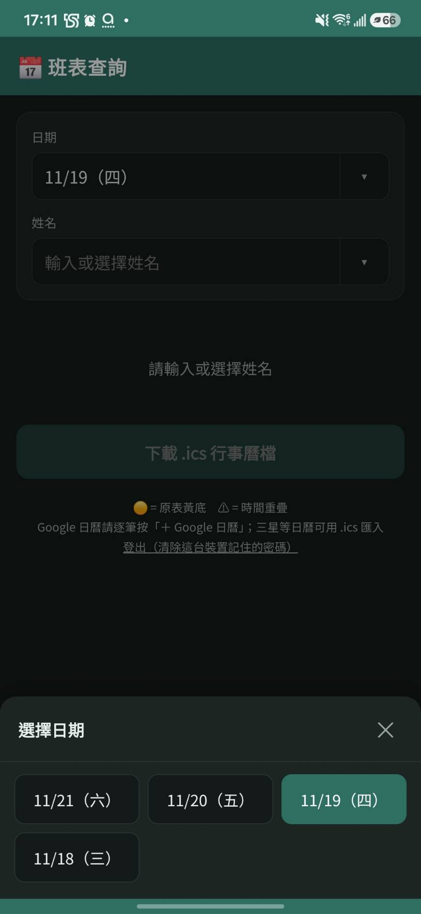
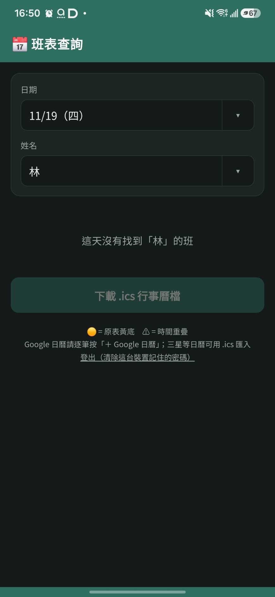

# 班表查詢

進站先輸入密碼，再輸入姓名查看當天班表，並加入手機行事曆：
- iPhone：按「加入 iPhone 行事曆」一次匯入（.ics）
- Android：每筆班按「＋ Google 日曆」；三星等日曆可下載 .ics 匯入

## 畫面示意
<table><tr>
<td align="center"><br>點日期旁的 ▾ 選日期</td>
<td align="center"><br>輸入或選擇姓名，顯示當天的班</td>
</tr></table>

## 安裝成 App
- iPhone：用 Safari 開網址 → 分享 →「加入主畫面」
- Android：用 Chrome 開網址 → 選單 →「安裝應用程式」
裝好後從主畫面開啟是全螢幕；沒網路時也能看上次看過的日期。iPhone 的主畫面 App 和 Safari 分開記憶，第一次開要重新輸入密碼。

## 結構
```
index.html               查詢網頁（純前端，輸入密碼後在瀏覽器解密）
data/index.json          日期清單＋解密參數（salt、密碼檢查值）
data/YYYY-MM-DD.json     加密後的每日班表（會上傳）
private/YYYY-MM-DD.json  明文班表（只在本機，不上傳）
.password                加密密碼（只在本機，不上傳）
tools/encrypt.mjs        把 private/ 加密成 data/
manifest.webmanifest、sw.js、icons/  加入主畫面（PWA）用
```

## 每日更新
1. 在 Claude Code 輸入 `/deploy_schedule <圖檔路徑>`（或傳班表圖，說「更新班表」）
2. 核對辨識結果
3. 把明文存成 `private/YYYY-MM-DD.json`
4. `node tools/encrypt.mjs`：加密最近 30 天的 `private/` 檔案到 `data/`，並更新 `data/index.json` 的日期清單。超過 30 天的班表會從網站移除，`private/` 裡的明文則保留在本機
5. `git add data && git commit -m "更新班表 YYYY-MM-DD" && git push`，約 1 分鐘後 GitHub Pages 更新

## OCR 設定（上傳者的電腦要做一次）
轉錄時字以 Azure AI Vision 的 OCR 為準，錯字比直接讀圖少。
1. 在 Azure 入口網站建立「電腦視覺」資源（區域 East Asia，定價層 F0 或 S1）
2. 到資源的「金鑰與端點」，把端點和金鑰寫進專案根目錄的 `.azure-vision.env`：
   ```
   VISION_ENDPOINT=https://<資源名稱>.cognitiveservices.azure.com/
   VISION_KEY=<金鑰1>
   ```
3. `python3 -m venv .venv && .venv/bin/pip install azure-ai-vision-imageanalysis`

`.azure-vision.env` 和 `.venv/` 已列在 `.gitignore`，不要 commit 金鑰。

## 資料格式（`private/` 裡的明文）
```json
{
  "date": "2026-11-18",
  "weekday": "三",
  "entries": [
    { "name": "王小明", "shift": "早班", "task": "衛教室", "extra": "+開25",
      "start": "08:30", "end": "12:30", "hours": 4, "color": "", "raw": "8'-12'(衛教室)4+開25" }
  ]
}
```
- `start` / `end`：台北時間，原表「'」代表半點（8' = 08:30）
- `color`：原表底色，`yellow` 會顯示 🟡；其他底色顯示為標籤

## 注意
- GitHub Pages 和這個 repo 都是公開的，所以上傳的班表一律是加密檔；`private/` 和 `.password` 已列在 `.gitignore`，絕對不要 commit。
- 加密：PBKDF2-SHA256（600,000 次）＋ AES-256-GCM。密碼是 6 位數字，只擋得住一般人。
- 換密碼：改 `.password`，刪除 `data/index.json`，再執行 `node tools/encrypt.mjs`（已記住舊密碼的裝置要重新輸入）。
